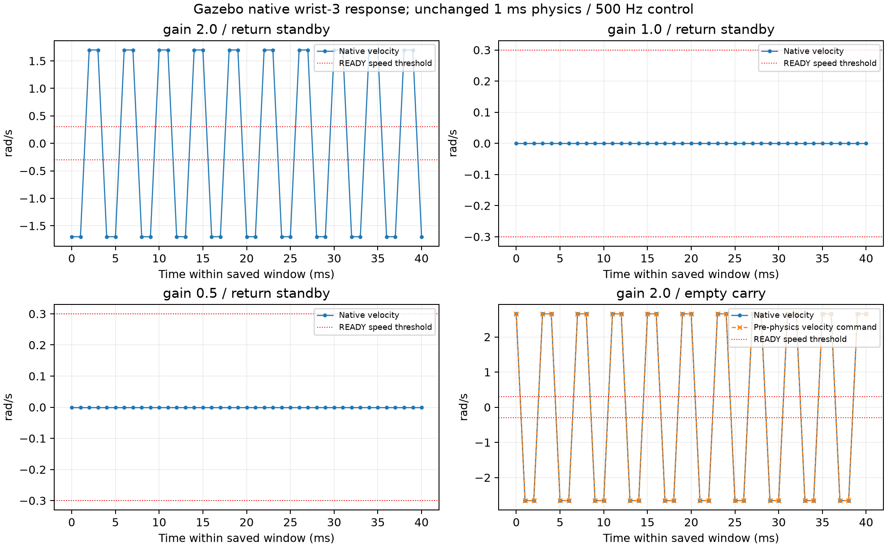

# 关节响应与负载核对

GAIN_COMPARISON.csv保存102个关节/阶段测量行，统一取每次Action结束后2sim秒窗口的最后1sim秒。没有够数据的启动失败/未到达阶段不补零，见CASE_SUMMARY.csv。

| gain | arm1返回腕3速度峰值rad/s | arm2返回 | 结论 |
|---|---:|---|---|
| 2.0 | 1.699040，约250Hz | arm1故障后未继续 | 不通过 |
| 1.0 | 5.96e-14 | 1.68e-14rad/s，两臂通过 | 候选，后完成带件及8件 |
| .5 | 5.96e-14 | 1.68e-14rad/s，两臂通过 | 仅空载通过，未验证抓放/8件 |

这些接近零的值是本仿真position接口的数值结果，不是传感器测量精度或现实机器人指标。频谱仅在信号高于1e-8分析噪声底时报告；该分析噪声底不参与READY验收，物理门槛未改变。

额外gain2命令探针在carry段速度/目标均约2.656321rad/s，位置峰差.002656321rad，原生命令与速度同相（相关≈1），相对于位置约44.96°，采样保持模型命令重建RMSE0。初始JTC逆解末点可能与参数关节目标有极小差异，命令模型使用真实下发轨迹末点，位置验收仍使用原standby目标。native实测与ROS数据共同排除单纯发布者错误；不将PostUpdate被清零的命令字段作为控制输入证据。

图前三格比较arm1返回，第四格为额外gain2的carry命令诊断，阶段不同已标明，不能把不同阶段的幅值当同一条件重复样本。PDF版本JOINT_RESPONSE.pdf。

## 负载、接触段与实际跟踪

gain1先运行两件Rule（blue/arm1、red/arm2），两件PLACED、2次真实READY、38次控制器结果成功、0重试/故障。两臂空载锚点与返回原生位置误差约1e-13量级，未见新增空载下垂。

保持目标数据中arm1肩关节在一次放置接触段偏差.136977675rad；历史gain2相同参考构型也有.136615267rad，差约.000362407rad。其他相同筛选保持段未见该偏差。该现象不能被漏报，也不能仅凭同阶段相关性断言其全部来自箱壁或全部来自重力。它不是降低gain后才出现的全新自由承载下垂模式；未改变原接触/补偿门槛来掩盖。

两件记录的finger_bin最大穿深.000136m，历史gain2蓝件诊断为.000180m；仅作有限对照，不能宣称各颜色完整统计等价。两件和8件没有interarm/body_bin类别，抓取接触原样保留。完整8件finger_part最大0.014026m、finger_bin最大0.000094m。接触点行不是独立碰撞次数，不能把无严重类别写成无接触/安全认证。

选择gain1：在所测空载目标上与.5均稳定，且gain1只需将原2减半、符合文档非振荡范围；随后只对gain1进行了真实带件/完整8件。没有声称已证明gain1全局优于.5或.5带载同样可用；gain10未测试。
