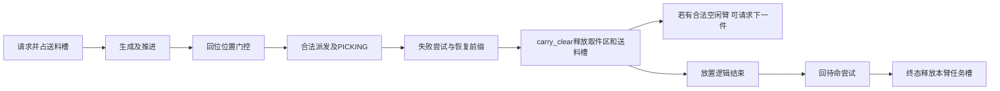

# V2模型：有限时序校准报告

基线72ab6f2；新独立分支perf/model-calibration-v2。实验源码位于worktree/ros2/codex_rl_v2/dual_arm_rl。原集成和性能工作树、旧Q、标记及历史数据均保留。schema_version=2；prefeed=false；单送料槽、取件区互斥及每臂单任务保持。没有新Gazebo。

## 数据划分与参数

先固定整轮划分再拟合：pair1/pair2双方共4轮32件训练，每色8件；pair3双方2轮16件留出；两个接触轮16件只诊断。留出结果在上阶段已公开，不是完全事前未知盲测；本轮未使用其数值拟合参数，也没有看其误差后调参。

| 颜色/固定执行臂 | n | 请求至PICK | 成功尾尝试至离区 | 重试前缀均值 | 离区至COMPLETED |
|---|---:|---:|---:|---:|---:|
| blue/arm1 | 8 | 6.045 | 11.731 | 0.000 | 12.388 |
| yellow/arm1 | 8 | 5.974 | 11.463 | 0.000 | 9.090 |
| red/arm2 | 8 | 6.033 | 11.658 | 3.361 | 9.183 |
| green/arm2 | 8 | 5.956 | 11.563 | 3.679 | 13.562 |

单位均为本机native插值仿真秒；每个参数保留source_case/part、n/min/max和原始事件行号。stage_summary同时有推进、回位home、放置逻辑结束和返回尾段。第一/第二次颜色出现位置的数据均保留，但模型当前使用颜色边际分布；不把第3次及以后放置位置当作已校准。

## 事件与观测模型

READY只指上述软件槽位语义；物理安全离区、真实零速度/standby证明未得到充分校准。V2将内部推进/home/place检查点与外部决策事件分开，WAIT只到真实槽位释放，Q观测仍为库存/READY或POST/ETA档/活动色十字段。ETA使用均值而非未来抽样成本；相关不泄漏及原q_feed兼容测试通过。

## 三种情景的边界

- nominal：纯敏感性，扣除观察到的失败前缀，保留最终成功尝试成本；不是物理上“如果没有失败会怎样”的真实反事实。
- mean：各色完整观察成本的均值，包含训练数据中的平均前缀。
- empirical_profiles（训练默认）：从每色8条真实整件记录均匀重采样，保留该件feed/pick/retry/post相关性。1/8只是明确的经验重采样假设，不是已可靠估计的物理失败概率；跨件/跨轮及顺序依赖未校准。

所有情景保留原idle_weight=.05。回调反应建模为瞬时，实际整批后续请求间隔仅数毫秒且低于插值分辨率；没有保留旧1s假设，也不声称真实延迟严格为0。随机profile取值不超训练记录范围，因此缺失的重尾/永久失败也不在模型里。

## 按整轮留出验证

给定真实已发生的出料顺序，用冻结参数预测整批首送料至终态，不使用留出重试数量或成本。

| 集合/模型 | 轮数 | MAE仿真秒 | 有符号偏差 | 最大绝对误差 |
|---|---:|---:|---:|---:|
| calibration/old_v1 | 4 | 41.904 | -41.904 | 53.897 |
| calibration/nominal | 4 | 14.138 | -14.138 | 26.281 |
| calibration/mean | 4 | 6.718 | -0.058 | 12.201 |
| holdout/old_v1 | 2 | 35.364 | -35.364 | 41.187 |
| holdout/nominal | 2 | 7.598 | -7.598 | 13.572 |
| holdout/mean | 2 | 6.482 | +6.482 | 12.456 |

留出Rule实际156.031s，均值预测168.488s；留出旧Q实际163.507s，均值预测164.015s。误差下降支持主要时序校准有用，但不能证明失败过程准确，也不能仅因两个误差较小宣称一般化完成。

另用真实每件成本强制回放，只验证事件账本：6轮残差约3–7ms（主要为请求回调间隔）。这是使用真实结果的teacher forcing，不是留出预测；没有用它来宣称模型泛化精度。

## 仍不足的数据

没有连续pusher零速度证据；ZONE_CLEAR仅既有几何轨迹门控；没有可靠的物理READY故障状态/转移模型；仅7个训练失败尝试、四轮，不足以分离策略/颜色/位置/负载的失败概率，且部分颜色0次失败。未观测第3+同色件、其他需求、首件yellow或任意新的交互轨迹；通用表这些场景依赖外推假设。需先补测，不把模型最佳当成Gazebo认证。
