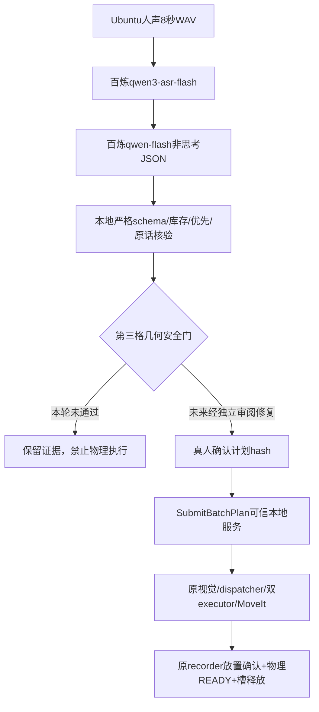

# 阿里云语音动态批次：实现与安全阻断交付

## 当前结论

真实中文ASR与真实LLM均完成，五件黄色优先候选正确。独立ROS批次接口和门控已开发、构建及离线/真实ROS通信测试。绿3静态路径出现指杆—箱壁相交风险，按规格停止进入Gazebo物理验收；没有宣布五件联合演示成功。

## 隔离及版本

从审核f6a7afc8ed7451e161023c6039b5f2494ea55ab6创建feature/aliyun-voice-batch-20261017。新工作树/home/yu/yuri_gazebo_performance/voice_batch_aliyun/worktree/ros2。原final_delivery_v2、ready_bugfix、control_stability、旧Rule/Q表和原始工作区不覆盖；不推GitHub、不合并PR、不训练/安装新依赖。docs2.zip只作报告/素材参考，没有迁移对方完整ASR或单臂执行器。

## 分层实现

云模型无ROS/运动连接；网络客户端不导入ROS。submit_cli才拥有ROS服务客户端，必须TTY真人确认、可信本地UUID和live session nonce。API付费授权与分拣确认分开；当前主计划未请求执行确认。

## 源码变化

- voice_batch_plan.py：关闭式候选schema、不可变计划哈希、中文显式数量/优先语义交叉核验；接受黄的/黄色的同义表达，不修造ASR文本。
- aliyun_voice_cloud.py：同一个私有Key用于两北京模型，域名白名单/拒绝重定向/45秒请求限时/最多4请求/无自动重试/不回显服务错误正文。
- voice_batch_state.py：纯状态机WAITING_FOR_PLAN→PLAN_PENDING_READINESS→RUNNING→COMPLETED或HALTED；逐件强串行；每件需真实PartInfo、PART_PLACED、物理ARM_READY及槽释放；同箱前件回收ACK+后续新鲜逻辑帧不见该件才允许再发。
- voice_batch_safety.py：执行许可与文本合法性分离，当前明确拒绝green>=3，无启动参数绕过。四箱schema容量仍<=3；拒绝主计划不是将需求偷偷改为两绿。
- SubmitBatchPlan.srv/CMake：独立强类型服务，原SortTask/TaskStatus字段不改。
- task_dispatcher_node.py：voice_batch_mode默认false；新模式门控初始readiness、ZONE_CLEAR、终态、Timer/看门狗全部送料入口；禁用旧SortTask旁路/Q；startup传感器观察保持新鲜；独立墙钟超时；故障保留槽、不再派发。
- result_recorder_node.py：仅voice模式在原DeleteEntity成功回调发PART_RECYCLED回执，原12sim秒回收及结果判据/CSV格式不改。
- sorting_demo.launch.py：新增默认false模式，voice必须显式Rule/双臂pipeline/v3/gain1；原Rule/Q默认选择不变。
- research_tools/aliyun_voice/：密钥人工导入、真实录音/云调用、人工确认服务客户端、当前阻断式演示入口、无GZ的ROS服务测试、只读FCL/几何审计源码。

## 仍未完成

未开展真实五件Gazebo；未物理核验绿3、无本轮5行结果CSV/5READY。完整受控Gazebo联合监督启动器尚未最终联调，run_voice.sh当前是安全检查阻断入口，不能冒称完整运行的仿真演示。恢复物理步骤需先Yuri审阅并解决第三格进出箱/夹爪碰撞风险，再完成有界监督与最多一次主验收；不得直接手改安全门常量让任务运行。
