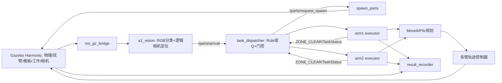

> 历史记录保留。2026-10-17最终gain1＋物理READY整合及唯一Q诊断请先读 [最终状态](../final_delivery_v2/FINAL_SYSTEM_STATUS_CN.md) 与 [Rule/Q验证](../final_delivery_v2/RULE_Q_VALIDATION_CN.md)。下文为较早阶段事实，不代表当前未修复。

# Yuri 双机械臂仿真研究：最终工程交接

交接日期：2026-10-16（Asia/Shanghai）。对象：Yuri、后续维护者及下一位 AI Agent。

**研究实验阶段已经结束。本轮只做代码、证据、GitHub Draft PR 和文档交付；没有新增 Gazebo 轮次、没有重新训练、没有执行16组配对。** 本文给出历史复现入口，不授权后续 Agent 自动启动它们。

## 1. 接手后先读的结论

1. 原始已验收目录 `/home/yu/ros_a1/ros2` 保留在083a515，源码未被性能实验覆盖。后续所有优化、整合、模型校准均在独立工作树进行。
2. 1ms步长+v3事件等待+无GUI/RViz+X11 llvmpipe+LP_NUM_THREADS=2有真实完整分拣证据；最佳已测批量吞吐来自8da的双实例。它不是72ab双实例新测量，也不是长期性能保证。
3. 2ms出现严重抓取失败，不采用。三实例23/24件正确、仅2/3完整批成功，不推荐。
4. 72ab三组低干扰配对，Rule平均184.59墙钟秒，V1修正Q平均187.96秒，各24/24入正确箱；Q未证明真实提速。不要把模型最优当成物理最优。
5. V2默认表在均值模型中与Rule同耗时；通用表接近旧Q。均值模型、随机经验模型、DP信息上界、真实Gazebo必须分开。
6. 最新诊断Rule第一件return_standby接口成功、_at_standby=True，但新鲜缓存的wrist_3_joint速度约2.886rad/s；触发停轮。正式CSV0行，Q轮未启动。这是有界安全诊断的截断结果，**不能作为Rule/Q失败率正式测量**。
7. Q表deployment_ready=false；配置与表overlap_validated=false。完整失败/物理READY/几何风险尚未充分校准，当前Q表不是生产就绪策略。
8. 优先审查控制器SUCCESS、物理静止、READY、COMPLETED和执行槽释放之间的关系。未解决前不推荐16组正式策略实验。

## 2. GitHub交付身份、分支与版本链

仓库：https://github.com/yuri0511/ros_a1 。目标base为`ros2-dual-parallel`，固定代码基线`72ab6f2b4d21eefe1ebb78b83aa8a413e00d7ddd`。最终准备时fetch确认远端该分支仍是72ab。

- 最终审核分支：`review/yu-gazebo-performance-rl-v2`。
- 审核分支地址：https://github.com/yuri0511/ros_a1/tree/review/yu-gazebo-performance-rl-v2 。**发布状态以GITHUB_UPLOAD_RECEIPT.md为准，不以这个可预测URL本身证明存在。**
- 首个代码交付提交：`f032aa23febcac7810085d131d2c9420f4a9c00e`。
- Draft PR：https://github.com/yuri0511/ros_a1/pull/1 。保持Draft，不合并。
- 登录者必须为`yuri0511`且viewerPermission为WRITE/MAINTAIN/ADMIN；未满足即停止，不切换其他账号代推送。
- 用户明确确认Yuri同意并由她本人完成官方网页认证。AI未请求、读取或记录密码、验证码或Token。使用CLI原生凭据机制，凭据文件不进入交付材料。
- 实际修改者署名为`Ping <311167715+Pingggg567@users.noreply.github.com>`，以用户指定的Ping及此前核验的Pingggg567身份为依据。AI辅助完成修改和审计；不因登录Yuri账号而把研究代码误署名给她。
- 最终审核分支从72ab重新整理研究差异，原各实验分支快照保留，不重写或删除。仅推送上面指定审核分支，不推送main、ros2-dual-parallel、dual-arm-rl。

| 历史层级 | 基线/本地快照 | 用途 |
|---|---|---|
| 原始验收 | 083a51568e20089d59f9c742da60637f2f03045b | 两轮原始8件GUI演示、日常脚本 |
| 8da性能 | 8da998b963eed3c70fda076329f04a75c8627ef3 → 86786e087fd9b9127ab08b978ee4dec57b6a7fcb | v1/v2/v3等待、1/2ms、1/2/3实例 |
| 72ab整合 | 72ab6f2… → 76dacf357b6a390683a71f7eecfbd1cd920c4073 | 逐项迁移、prefeed=false、V1模型/真实配对 |
| V2校准 | 72ab6f2… → e2a82c98a6804720145b7bdc139e22eb3ce02011 | 本机原始轨迹校准、schema2、离线训练/DP |
| 诊断保护 | e2a82c9… → 2b482b7（完整SHA见审计） | 单次Rule停轮，只读观察及终态前阻断 |
| 先期本地审阅 | review/local-72ab-v2 / 410214c | 历史审核包代码/文档准备，不是本次远端分支 |

早期快照使用Local Experiment Archive占位作者，只用于保全。最终审核提交使用真实指定作者；原快照仍保留。本文引用首个代码交付SHA，后续文档提交会使分支HEAD前进；最终精确HEAD见本地上传回执和GitHub API，避免在文件中伪造其自身提交哈希。

## 3. 系统架构与事件关系

ROS2工作区有四包：`a1_interfaces`、`a1_cell_sim`、`a1_sorting_core`、`a1_vision`。不是根目录ROS1工程。机器人为两台UR5e，共用一个move_group规划环境；流水线配置可把执行送到各自joint_trajectory_controller，仍保留原执行槽/规划约束。



`cell_bringup.launch.py`复用官方ur_simulation_gz启动UR描述/控制器，补充世界、传感器与服务桥、夹爪和按需工件。`sorting_demo.launch.py`在其上组合MoveIt、视觉、调度、双执行器、场景与结果节点。

- `/clock`由各实例自己的世界产生，ROS节点用use_sim_time；原生`/world/sorting_cell/stats`提供sim_time、real_time、iterations和step_size。
- `/overhead_camera`为RGB，`/overhead_logical`提供几何观测；关闭GUI并没有关闭传感器渲染。视觉分类没有用预设正确颜色代替。
- 推板为真实接触推进，速度命令`/model/pusher/joint/pusher_slide/cmd_vel`；回位和派发有原位置/停稳门控。
- `TaskStatus`中PICKING、ZONE_CLEAR、COMPLETED/FAILED含义不同。ZONE_CLEAR用于共享取件区锁释放，允许另一臂取件与当前臂后半程重叠；当前臂任务槽通常到终态才释放。
- 执行器先缓存逻辑终态，finally中尝试return_standby后flush。**原代码即使返回失败，也可能flush终态；失败路径不是可靠物理READY证明。**
- result_recorder沿用原箱体/工件结果判断。成功后12仿真秒回收工件；末帧不一定同时保留8件，不能把最后空世界解释为分拣丢件。

## 4. Rule与Q调度接口

Rule使用choose_idle_feed：依闲臂/上一送料臂和累计颜色数量平衡送料；默认序列在已观察轮次为blue、red、yellow、green各循环一次。模型中名为rule_action的基线与ROS规则实现并非所有状态完全相同，V1评估已单列比较。

72ab的正式`feed_policy`默认值为q。此事实没有被修改。研究中的Rule必须显式`feed_policy:=rule`，启动应显示“退回谁闲推谁”。不要以旧Q缺文件自动回退代替明确Rule对照。

`q_feed.py`保留72ab原相对路径加载器、配置/表校验和回退；原`ros2/codex_rl`及正式默认Q表未被V2覆盖。V2是独立`ros2/codex_rl_v2`，schema=2，只有通过实验`policy_params`指定包、配置、表才会接入。

实际Q观察为10字段：remaining四项、两臂READY/POST_PICK、两项离散ETA、两项活动色。ETA来自配置均值减已经观察的POST历时，不得使用本轮未来实际失败/返回时长。prefeed=false意味着忙臂不能预送料；单槽、pick_owner和每臂一任务保留。

ROS适配器为允许WAIT合法性而加入dummy 1秒内部事件，**没有在ROS中step这个模型事件**；它不是现实时间等待器。V2模型中的WAIT跳过内部放置事件，直到真正ARM_READY再决策。旧物理Q三配对WAIT为0，因此不能把WAIT语义直接说成其变慢原因。

加载日志`Q_AUDIT_LOAD`与每步`Q_DECISION`记录配置/表哈希、状态、ETA、合法动作、选择、回退。未知状态仍有合法动作回退，应计数，不能宣称通用表全状态覆盖。

## 5. Windows、VMware与Ubuntu环境

| 项目 | 状态/证据 |
|---|---|
| VMware Workstation | 26.0.1，用户提供；未改宿主配置 |
| VM规格 | 12 vCPU、24GB RAM、100GB虚拟磁盘 |
| Ubuntu | 24.04.5 LTS x86_64 |
| 内核 | 原环境日志7.0.0-38-generic |
| ROS2 | Jazzy，经RoboStack/Pixi锁定环境 |
| Pixi | 0.82.0 |
| Gazebo | Harmonic/libgz-sim8 8.10.0 |
| MoveIt | 2.12.4 |
| RViz | 14.1.24 |
| Python/setuptools | 锁定3.12.15/79.0.1；未升级 |
| 渲染 | Gazebo X11/Xwayland llvmpipe；日常GUI方案RViz可走SVGA3D |
| 本次新增工具 | 官方GitHub CLI 2.102.0，仅交付所需，不是ROS依赖更换 |

Windows具体版本、宿主GPU实际分配无本次系统测量，不编造。Guest可见VMware SVGA II/vmwgfx；Gazebo SVGA3D路径虽能初始化但GUI/RGB异常，未通过；EGL路径也未认证可用。不能称RTX直通成功。原始GUI验收分开渲染：Gazebo llvmpipe，RViz VMware路径；性能轮则无GUI/RViz。

桌面使用DISPLAY=:0、QT_QPA_PLATFORM=xcb，XAUTHORITY随会话变化，不应复制旧值跨会话。LP_NUM_THREADS=2只控制llvmpipe线程，不是物理并行度。共享文件夹探测未列出任何已配置/挂载目录；SSH当时未启动，不能声称Windows可直接读取Linux路径。未更改Windows、VMware硬件、GPU驱动、安全设置。

CLI按官方https://github.com/cli/cli/blob/trunk/docs/install_linux.md 的签名apt源安装，keyring SHA核对、完整日志保留在final_delivery/audit/install-gh.log。该工具安装不改变Pixi锁文件。网页登录由Yuri本人在独立终端操作，不采集认证窗口内容。

## 6. 所有关键目录及用途

| 本地绝对路径 | 内容与使用限制 |
|---|---|
| /home/yu/ros_a1/ros2 | 083a原始已验收工作区，不修改 |
| /home/yu/ros_a1/ros2/.pixi/envs/default | 共享锁定运行环境，只读复用 |
| /home/yu/run_yuri_ros2.sh | 原GUI一键脚本，有重复启动保护 |
| /home/yu/run_yuri_ros2_software.sh | 原全软件备用脚本 |
| /home/yu/yuri_ros2_tools/bin/ruby | 只给Gazebo注入软件渲染的原包装器 |
| /home/yu/yuri_ros2_logs | 初始安装/兼容/两轮验收全部日志 |
| /home/yu/.ros/a1_sorting_results.csv | 原16行成功件记录，未清空/覆盖 |
| /home/yu/yuri_gazebo_performance | 原083a性能与后续总根目录 |
| /home/yu/yuri_gazebo_performance/fast_sim_8da998b | v1/v2/v3、1/2ms、并行性能实验 |
| /home/yu/yuri_gazebo_performance/integration_72ab6f2 | 72ab整合、V1训练/DP/真实配对 |
| /home/yu/yuri_gazebo_performance/model_calibration_v2 | 轨迹审计、校准CSV、模型V2/Q/DP、留出验证 |
| /home/yu/yuri_gazebo_performance/yuri_review | 原审核ZIP、manifest、审阅文档及基线归档 |
| /home/yu/yuri_gazebo_performance/yuri_review/diagnostic | 最新停轮诊断工作树、观察器、数据和保护补丁 |
| /home/yu/yuri_gazebo_performance/final_delivery | 最终交接、上传回执、摘要、证据索引与交付审计 |
| /home/yu/yuri_gazebo_performance/final_delivery/worktree | 本次唯一待推送审核分支的独立工作树 |

原部署报告在`/home/yu/yuri_ros2_setup_report.md`及聊天outputs副本。原生证据目录包括hardware-20261016T111642+0800、hardware-dri2-20261016T112112+0800、hardware-gl33-20261016T112236+0800、software-20261016T112332+0800、hybrid-20261016T113015+0800。

## 7. 初次部署与1ms基线

原项目以HTTPS单分支克隆，只构建ros2/四包。Pixi官网下载器曾报runtime dropped the dispatch task，最终`pixi install --locked --concurrent-downloads 1`成功，未改锁、未绕过验证。安装约6分钟、988锁包/约6.5GiB是当时记录，不是本轮重新安装结果。

执行沙箱曾造成/dev/dri访问故障，切换完全访问模式后恢复；没有通过改Guest安全策略解决。源码构建四包6.53秒；CMake兼容警告保留。原两轮8件全对，全软件277.35墙钟秒、Gazebo软件+RViz VMware分开渲染244.04秒。局部RTF约0.7–0.8，窗口统计与整轮RTF不能混用。

最终渲染方案通过私有PATH包装器匹配ruby启动Gazebo，设LIBGL_ALWAYS_SOFTWARE=1、GALLIUM_DRIVER=llvmpipe；其他节点/RViz保留合适环境。原launch源码未因此覆盖。虚拟机无需安装NVIDIA/CUDA或apt ROS。

## 8. 事件等待、RTF与并行性能优化

所有研究修改默认由fast_sim_waits=false关闭。修改点在dispatcher、executor、motion_client和launch；原Q加载器/正式YAML保留。独立fast_sim_1ms.sdf固定max_step_size=0.001，目标RTF4只是运行上限配置，实际从stats差分测得。

- 首送料固定20墙钟秒改为有界就绪：世界时钟、逻辑相机、RGB、推板home、spawn服务/订阅、推板桥/Transport订阅、控制器、MoveIt全部满足才送料；总上限60墙钟秒。不就绪拒绝送料。
- v2释放仅用于启动检查的临时RGB订阅，相机和原视觉继续工作。v2曾出现启动检查漏发现GZ订阅而超时；v3加入同partition有界CLI核验、控制器RPC2秒重试、3秒新鲜回复要求，未绕过条件。
- 抓取后额外1.5秒只在原GraspVerifier通过、至少约31样本对、1.5秒实际跨度及至少15个不同新鲜相机帧等证据充分时提前结束；物理探针、夹持、验证和恢复保留。
- MotionClient通过Future/执行槽Event唤醒减少轮询延迟；原受理/执行/排空/取消和故障超时保持。默认未走到的1秒dispatch分支/1.5秒drop-return分支不虚报收益。
- 释放后0.4秒保留。attach跟随约40Hz墙钟、部分闭爪/故障等待仍是现实时间，未把所有定时器任意换仿真时钟。

8da同提交初始配对：1ms原等待224.3秒→事件等待201.3秒，均8/8，RTF .886/.890，墙钟少23秒（10.2%）。这是单组观测，不是每台机器稳定收益。最快单次169.4秒来自早期v1；v3单实例175.9/184.3秒、RTF约1.028，第一轮虽入箱全对仍有return目标时间中止，不能称动作全可靠。

| 8da v3 | 成功完整批/总批 | 正确件 | 总墙钟 | 吞吐 |
|---|---:|---:|---:|---:|
| 双实例首轮 | 2/2 | 16/16 | 299.2秒 | 24.07批/小时 |
| 双实例复测 | 2/2 | 16/16 | 293.7秒 | 24.51批/小时 |
| 双实例合并 | 4/4 | 32/32 | 592.9秒 | 24.2866批/小时，含清理23.6553 |
| 三实例 | 2/3 | 23/24 | 413.2秒 | 17.4253批/小时 |

每小时批次=3600×成功完整独立批次数/整组总墙钟，不能相加RTF。双实例各RTF约.70–.72，CPU均值约78%；三实例RTF约.47、CPU88.3%，有yellow OUTSIDE：观测XY(.837,.220)、目标(.870,.230)，不扩大箱界修复结果。短轮速率不是连续运行一小时或最大理论极限。

实例各自ROS_DOMAIN_ID、GZ_PARTITION、HOME、ROS_LOG_DIR、CSV，复用相同锁定依赖和构建。共享世界名sorting_cell不跨partition服务；/clock、RGB、控制器用来源和标记检查。原083a阶段做过暂停/重置/停止一实例而另一继续。CPU饱和、Swap、OOM和外来GZ有停止保护；RSS共享页不可直接求和当总占用。

## 9. 2ms失败：为何拒绝

8da低干扰完整批次，原等待2ms仅1/8正确，事件等待2ms0/8正确，成功批数均0。其RTF约1.051/1.095并不能抵消任务失败，后续精密诊断在首次永久失败时停轮。

错误包括工件不在夹爪下、跟随位移/方向不符、偏心、规划/关节加减速失败等。2ms原等待也失败，不能只归咎Python事件等待。500Hz控制周期恰等2ms并不证明数值兼容。失败后的残留会影响后件，各件失败并非独立伯努利样本。未改增益/几何/速度/锚点/碰撞阈值“修好”结果，不运行2ms正式训练。

## 10. V1修正、V2校准、训练与DP

### 10.1 旧Q与prefeed修正

Yuri旧表训练allow_prefeed_busy_arm=true；ROS实际decide_feed拷贝配置强制false。旧训练合法动作集比现实宽。72ab整合独立配置将prefeed设false并从空表重新训练，不是改JSON后复用旧表；原旧表保留。

V1 demo2222与general8各50000个**离线模型回合**，seed42、alpha.2、gamma1、epsilon线性.5→.05，状态292/1806；各约9–10秒本机训练。两张共100000模型回合，绝不是Gazebo100000轮。V1配置canonical SHA为0a2a549827d9f23b8791fd66b48caaeab824095091f432f8b0e22b082ca38223。

V1模型Rule126.490秒，新Q/旧Q合法动作过滤历史参照122.320秒；时间DP122.320。DP枚举同模型所有合法FEED与WAIT，含单槽/忙闲/取件锁和完整事件队列，非仅颜色全排列。Q达到此简化模型时间最优，但模型漏推板回位/重试/真实READY等，不能推出真实收益。

### 10.2 V2数据划分、边界与不确定性

来自本机72ab、1ms、v3已存原始数据，未新增物理训练。pair1/2双策略四整轮32件校准，pair3双策略16件整轮留出，精密Rule/Q16件仅诊断，共64件表格。按轮分组而非拆散同轮工件；pair3结果此前已公开，所以不是盲法前瞻留出。

CALIBRATION_DATA.csv、parts.json、TRACE_EVENTS.csv、batches.json记录来源行号、时间和SHA。`*_wall`为原日志epoch；`*_sim`由native stats包围插值定位；`*_ros_observed_sim`才是保存的精确ROS观测。最大时钟差样本.052秒不是严格误差界。跨线程先发布再打印可使日志顺序反转，ZONE_CLEAR采用dispatcher释放点，并单独留执行器消息。

V2显式feed/advance-stop/home/pick_nominal/retry_prefix/place/return_tail/post阶段，逐色/执行臂成组profile。同一颜色在默认系统固定路由至对应臂，因此颜色效应和臂效应不能独立识别。每色仅8个训练工件，红/绿4件涉及7次失败尝试；不能把7/32当独立失败概率。

经验整件profile重采样保留同件阶段相关，但均匀抽样/跨轮可交换性是模型假设，不是充分校准的真实故障分布。未建完整永久失败、FAULT、碰撞和物理READY；第3+同色件没有对应本机放置时长支持。名义“无重试”是代数扣除prefix的敏感性实验，不是可证物理反事实。

### 10.3 V2冻结与结果

- schema2，prefeed=false；demo/general各从空表50000模型回合，seed42，不挑种子重训；状态292/1806。
- config canonical SHA：ce65cec200920de7f3116ddedffcee900aba21b8d07af405bc84359017c1ca0b。
- config文件SHA：574a24115d663c8a73c30f897f6b824bd32a6357803147e4a35e76b6339f6b01。
- demo Q SHA：10f320eba3c8e0c1118910ae9c99a49e3b06acd7470d18a71dd5bba08eca9fe4。
- general Q SHA：18c4b343b0c359b2c740d9d6eeabef273be3d93e4e573ee28a32b53216977e2c。
- 超参数alpha=.2、gamma=1、epsilon .5→.05；本机训练约11.99/13.06墙钟秒。本次最终交付没有再训练。

| V2均值情景 | 模型秒 | time+.05×idle代价 |
|---|---:|---:|
| Rule / V2 demo | 168.488 | 174.285 |
| 旧Q历史参照 | 164.015 | 169.782 |
| V2 general | 164.015 | 170.001 |
| 时间DP | 164.015 | 170.001 |
| 加权DP | 164.108 | 169.693 |

通用Q达到均值情景最短时间，但非最小加权代价；默认Q未胜Rule。200个独立共同经验场景中Rule/demo168.524秒，旧Q/general164.150秒。普通Q不能看未来profile；固定场景DP若知道未来profile和完整事件队列是额外信息最优上界，不是相同信息条件的可部署最优策略。

通用表165种8件库存全部模型完成，4/1822决策未知回退约.22%；默认表1210/1849回退约65.44%。合法动作检查不证明几何安全。32条旧ROS观察经schema2原适配器重建一致，也不等于新策略Gazebo轨迹验收。

留出两轮真实仿真时长Rule156.031/Q163.507秒，均值模型误差约+12.456/+.508秒，MAE6.482秒；比V1的35.364改善但仅两个轮次。用真实每件成本teacher forcing后残差3–7ms只验证记账，不是预测能力。

## 11. 真实Gazebo策略配对：已测事实与不能推出的结论

72ab精密功能Rule/Q各一轮8件入箱正确；另有低干扰三配对，顺序Rule→Q、Q→Rule、Rule→Q。后者各24/24，Rule平均184.59墙钟秒、Q187.96秒，Q慢3.37秒/+1.83%；重试3比7。Q24次全部命中、未知回退0、WAIT0；独立Q功能轮另8次命中，共32次旧Q决策接入证据。

真实送料顺序与V1模型相符：Rule blue red yellow green blue red yellow green；旧Q red blue green yellow green blue red yellow。未强制新V2 Q首色。

Q−Rule关键路径均值墙钟：送料−.856秒、最后成功PICK→离区−5.531、重试prefix+13.417、请求间隙+.00287、末尾return/终态tail−2.8176；链条净+4.2154，启动/CSV边界差后整批净+3.37。三对额外重试prefix差累计约40.25秒，算术上足以覆盖总10.11秒净差，但无法把相关性当因果；策略、姿态、顺序和随机失败可能共同作用。不能删重试成本声称Q真实更快。

精密Q历史有返回待机规划拒绝和后续初始standby控制器中止，不能说所有动作可靠性通过；详见下一节。低干扰三对没有控制器中止，但不足以证明无此风险。

## 12. 最新READY异常、历史故障及碰撞证据

### 12.1 最新诊断路径与时间

完整目录：`/home/yu/yuri_gazebo_performance/yuri_review/diagnostic/runs/20261016T171634-diag-rule/instance-1`。

Rule显式启动，第一件blue交arm1；ZONE_CLEAR后第二件red已在故障前正常交arm2，符合既有重叠门控。part1逻辑完成日志带“待收尾后上报”，不是已发布终态。return_standby控制器SUCCESS后观察到：

- fault墙钟1792142237.332762，ROS sim36.921秒；启动到触发42.777墙钟秒。
- _at_standby=True；关节缓存新鲜度约1.073ms。
- wrist_3_joint位置−1.8793143，目标−1.8822，误差约.00288567rad，位置接近目标。
- 速度+2.8856723rad/s，未满足原_joints_settled速度.3rad/s；原位置阈值.55rad、新鲜度.5墙钟秒均未修改。
- 独立5Hz JointState触发前约.092秒速度2.999634，触发后约.108秒速度2.885672，说明有额外观测支持，不只有报警自己的一行数值。
- 保护在return结束边界阻塞该任务线程，尚未flush终态/释放本臂槽；监督器约.390秒后收到pause服务data:true；故障后新增送料0。另一臂原先已在运行，不宣称暂停零延迟。
- 原生最后pose sim37.242秒，完整生命周期56.660墙钟秒包括暂停/清理；不是8件批次耗时。
- 结果CSV仅表头，0正式完成行；观察器未见TaskStatus COMPLETED。part1原生位置约(.277869,.236795,.745000)，在蓝箱，但不计成完整批次。
- Q轮没有启动，Gazebo中V2 Q决策0。离线前置校验命中不替代真实加载/接入证据。

本轮没有记录return规划失败或goal_time abort。无法只据速度判断大幅偏离待机，也无法认定永久硬件/控制器故障。可能原因包括高频数值振荡、关节速度发布语义、SUCCESS只保证目标/容差而未保证静止、缓存时序；均为未验证假设。

### 12.2 历史72ab精密Q需要一起看

历史`20261016T152034-q-acceptance-contact`：part6 arm1 return_standby被MoveIt预测arm2_gripper_base与gripper_finger_left_link碰撞拒绝，返回失败后仍能发布COMPLETED/释放槽。part8初始standby出现goal_time中止，原代码警告后仍_at_standby=True并继续。规划预测碰撞不等于真实已发生双臂接触。先前报告把两事件混称“返回超时”的简写，应以原日志和V2校准审计纠正。

### 12.3 接触与安全限制

最新原生接触55064点：未观测双臂/非夹爪臂身-箱体接触，但有手指-箱壁最大.299mm、最长观测段2.310仿真秒；手指-工件最大11.448mm，另有手指-输送结构。数值原样保留，不凭类别或深度宣布安全。点数不是独立碰撞次数，<=40ms连段只是观察跨度，不能乘名义50Hz制造持续时间。

历史8da v3有夹爪基座-工件最大.616mm、14ms；72ab精密Q有上臂-黄色箱壁最大约.197mm、观测段4.012秒。保持原几何/阈值也不能证明轨迹接触完全等价。已做真实mesh正向接触对照，不代表覆盖全部姿态。

推板位置/速度命令/home日志/世界pusher_link位姿均存，但原世界未发布推板关节真速度，本次不加插件改场景；有限差分是估计，不以cmd_vel=0或到home阈值冒充已停稳。原结果判定和12秒回收仍保留，逻辑完成与物理落稳分开。

## 13. 代码、测试与还未补齐的证据

性能改动通过fast_sim_waits及独立世界/launch参数启用；原YAML、q_feed、原codex_rl、机器人URDF/Xacro、碰撞/增益/规划控制参数、pixi.lock不覆盖。正式默认Q还是72ab的原表，V2只在独立路径。

上传包含：性能Python/launch小改动与新增测试、独立1ms世界、V2模型/训练/DP工具、历史研究驱动、V1/V2小型Q与配置/评估元数据、必要校准表/来源清单、审阅文档与最新诊断关键原文。diagnostic-only保护以单独patch供审核，未混入正式executor状态机或作为修复上线。

历史72ab全量157通过、4既有失败：

1. test_camera_pose.py::test_world_image_camera_h_fov_final_135（依赖缺失G0证据）。
2. test_legacy_anchors.py::test_relay_section_identical_between_both_tables（旧relay键集合假设与配置不符）。
3. test_legacy_anchors.py::test_wired_anchors_match_G0_anchors_v3_json（缺证据）。
4. test_legacy_anchors.py::test_anchor_table_gates_and_belt_stop_are_pinned（缺证据）。

未伪造G0_anchors_v3.json，也未删断言把它们伪装通过。最新诊断37项相关测试通过；V2隐藏未来、ETA/WAIT、DP小批次独立穷举、165种需求合法性均有记录。最终交付构建/测试实况见audit/build-final.log、pytest-final.log和XML；首次未source接口安装导致收集失败的日志另保留，不冒充代码回归。最终本地复测为157通过、4个同名既有失败（含vision测试，总数仍161）；四包构建6.10秒。未source接口安装的首次收集错误已按真实环境问题保留，完成本工作树构建和source后消除。

## 14. 运行、构建、测试、停止、恢复命令

**以下是接手者复现说明，本次交付不执行任何仿真/训练。先解决READY缺口，再由人明确批准物理测试。** 原脚本有绝对ROOT，不得在新机器直接运行历史迁移/写报告脚本覆盖旧目录。

### 14.1 只读检查与构建/单测

```bash
cd /home/yu/yuri_gazebo_performance/final_delivery/worktree
git status --short
git worktree list
git remote -v
git log --oneline --decorate -8
source /home/yu/yuri_gazebo_performance/integration_72ab6f2/activate.sh
cd ros2
colcon build --symlink-install --base-paths src
source install/setup.bash
python -m pytest src/a1_sorting_core/test src/a1_vision/test -q
```

该activate只设置共享CONDA_PREFIX及激活脚本，不下载依赖。在没有既有环境的新机器，依据pixi.lock用官方Pixi安装：`pixi install --locked --concurrent-downloads 1`，不要升级锁。此处不是本次重新安装指令。

### 14.2 日常原始GUI与历史性能入口（当前禁止自动启动）

```bash
/home/yu/run_yuri_ros2.sh
/home/yu/run_yuri_ros2_software.sh
/home/yu/yuri_gazebo_performance/fast_sim_8da998b/run_fast.sh 1
/home/yu/yuri_gazebo_performance/fast_sim_8da998b/run_fast.sh 2
/home/yu/yuri_gazebo_performance/integration_72ab6f2/run_policy.sh rule 1
/home/yu/yuri_gazebo_performance/integration_72ab6f2/run_policy.sh q 1
```

最后一条是V1修正表，**不是V2**。运行前检查源码HEAD与脚本固定基线保护；早期脚本可能以git HEAD应等8da/72ab为闸，后来归档提交使HEAD前进，应在新的副本中人工复核保护后适配，不能粗暴删重复启动锁。

新审核树V2候选覆盖文件：`ros2/codex_rl_v2/config/review-general.yaml`。正式完整launch示例（仅供复现，当前不执行）：

```bash
export LIBGL_ALWAYS_SOFTWARE=1 GALLIUM_DRIVER=llvmpipe LP_NUM_THREADS=2 QT_QPA_PLATFORM=xcb
export ROS_DOMAIN_ID=91 GZ_PARTITION=review-single-UNIQUE
export ROS_LOG_DIR=/ABS/NEW_RUN/ros
ros2 launch a1_sorting_core sorting_demo.launch.py gpu_offload:=false gazebo_gui:=false launch_rviz:=false world_file:=fast_sim_1ms.sdf fast_sim_waits:=true feed_policy:=rule result_csv:=/ABS/NEW_RUN/results.csv
# Q候选在相同条件显式替换feed_policy:=q，并增加：
# policy_params:=/ABS/WORKTREE/ros2/codex_rl_v2/config/review-general.yaml
```

每轮新目录，颜色需求[2,2,2,2]，不能手改首色。仅启动上述launch并没有诊断安全保护；不建议在现存READY缺口下直接使用它做配对。

### 14.3 最新诊断原始命令（已经执行一次，不再自动重跑）

```bash
PERF_POLICY=rule PERF_CONTACT=1 python3 /home/yu/yuri_gazebo_performance/yuri_review/diagnostic/tools/run_case.py diag-rule 1 true 1 420
```

被阻断而**未执行**的Q命令：

```bash
PERF_POLICY=q PERF_CONTACT=1 PERF_POLICY_PARAMS=/home/yu/yuri_gazebo_performance/yuri_review/diagnostic/candidate-general.yaml python3 /home/yu/yuri_gazebo_performance/yuri_review/diagnostic/tools/run_case.py diag-q-v2-general 1 true 1 420
```

### 14.4 离线模型复现（需要新输出副本，当前不重训）

历史V1：integration_72ab6f2/tools/train_audit.py、dp_baseline.py；V2：model_calibration_v2/tools/extract_traces.py→freeze_model.py→train_v2.py→evaluate_v2.py→adapter_audit.py→oracle_general.py→assess.py→write_reports.py。**这些历史脚本有硬编码输出目录，直接运行会写已有文件。先复制整个实验到新目录并改全部ROOT/来源映射，绝不能在原目录盲目重跑。** finalize.py/migrate.py亦不可当通用入口执行。

通用表可用独立CLI在新目录复现（示例不执行）：

```bash
cd /ABS/WORKTREE/ros2/codex_rl_v2
python -m dual_arm_rl.train --config config/timing.v2.json --output /ABS/NEW_OUTPUT/q-general.json --episodes 50000 --batch-size 8 --seed 42
```

固定demo2222应按原train_v2.py调用train(...,batch=[2,2,2,2])；CLI无fixed-batch参数，不可误称上述命令训练demo。DP工具源码在codex_rl_v2/experiment_tools/evaluate_v2.py的Solver，复用legal_actions/step；执行入口需调整R并保留同配置/信息条件。仅评估不要调用train_v2。

### 14.5 正常停止、暂停与故障停止

- 前台原launch使用Ctrl+C（SIGINT）；等待退出并核查PID。只按保存的会话清理，不全局pkill。
- 实验harness整轮停止：`touch /ABS/CASE/STOP`。
- 独立实例停止：`python3 /home/yu/yuri_gazebo_performance/integration_72ab6f2/tools/instance_control.py /ABS/CASE 1 stop`。
- 暂停：同上把stop换pause；恢复unpause。必须使用该CASE保存的ROS_DOMAIN_ID/GZ_PARTITION。
- reset命令只重置Gazebo世界，不重置ROS调度/计数/锁状态，不能以它冒充干净新回合。失败任务后优先完整停止、保存、独立新启动。
- 新诊断保护写guard-fault后同步阻塞本臂终态前路径，监督器20Hz读文件、调用世界pause服务，再SIGINT；15秒仍未关闭执行器则退出86。保护是终止实验机制，不是正式READY修复。

检查残留可用`ps -eo pid,ppid,sid,comm,args`，按保存PID/会话核对Gazebo、move_group、executor、dispatcher、bridge，避免杀别的任务。交付审计用/proc逐进程可执行名读取，末次应为空。

### 14.6 数据完整性及恢复

```bash
cd /home/yu/ros_a1
sha256sum -c /home/yu/yuri_gazebo_performance/original-tracked-files.sha256
cd /home/yu/yuri_gazebo_performance/yuri_review
sha256sum -c ARCHIVES_SHA256.txt
unzip -t Yuri_Review_72ab_V2.zip
unzip -t Yuri_Evidence_72ab_V2.zip
git -C /home/yu/ros_a1 bundle verify local-experiment-snapshots.bundle
```

ZIP解压到**新空目录**，在解压主包根目录`sha256sum -c MANIFEST_SHA256.txt`；EVIDENCE_FILES_SHA256.txt对应独立证据包的原相对路径。不要向原历史目录覆盖解压。Git补丁在新72ab分支上先`git apply --check /ABS/PATCH`再应用。bundle可fetch到新临时分支用于恢复，不reset --hard已有工作树，不force覆盖已有分支。

原CSV SHA256为9d1a577e9b0aa7086af45c07268eabbdfd84373c921351078fe77d4fa83d5799。V2表/配置SHA见第10节。研究包SHA与大小见EVIDENCE_INDEX.md。先比较哈希再恢复，不凭文件名认定同一版本。

## 15. 上传边界、证据索引与数据管理

主审核ZIP为/home/yu/yuri_gazebo_performance/yuri_review/Yuri_Review_72ab_V2.zip；大型原始证据为同目录Yuri_Evidence_72ab_V2.zip。它们保留在本地，**不进Git仓库**。Pixi依赖、build/install/log、重复缓存、大型接触CSV不无差别上传。Git里只有适合审查的小型JSON/CSV、关键原文摘录、源码/补丁、报告与来源哈希。

完整日志首要路径：

- 8da：fast_sim_8da998b/runs/*/instance-*/{launch.log,stats.jsonl,results.csv,contacts.csv或gz}，每case有analysis/extra-analysis及metadata。
- 72ab：integration_72ab6f2/runs/20261016T151726-rule-acceptance-contact、152034-q-acceptance-contact，以及152337-pair1-rule、152643-pair1-q、152947-pair2-q、153312-pair2-rule、153628-pair3-rule、153936-pair3-q；完整文件名带日期前缀。
- 校准：model_calibration_v2/{CALIBRATION_DATA.csv,data,raw,training,tools,audit}；raw为已保存原始来源副本，SOURCE_MANIFEST逐文件哈希。
- 新诊断：yuri_review/diagnostic/runs/20261016T171634-diag-rule/instance-1/{launch.log,guard-fault.json,diagnostic.jsonl,observations.jsonl,stats.jsonl,results.csv,contacts.csv,ros/}。
- 新诊断摘要：yuri_review/DIAGNOSTIC_PAIR_REPORT.md及diagnostic/audit/{diagnostic-result.json,preflight.json,guard-tests.json,runtime-source-proof.json}。
- 最终审计：final_delivery/audit/{install-gh.log,build-final.log,pytest-final.log,privacy-scan.json,integrity.json,auth-identity.json,remote-before.json,upload-verification.json}（仅已完成步骤生成对应文件，认证凭据不保存在这里）。

一次分析工具误保留旧ROOT，更新了72ab的派生comparison.json；已保存误写输出并从诊断前ZIP按字节恢复，原始传感器/CSV未受影响。修正路径后完整性再核验通过，记录在yuri_review/audit/derived-summary-restoration.json。该已纠正的工具错误不应隐藏，也不应误称真实实验数据被重采样。

## 16. Yuri与下一位Agent的优先事项

P0：审查原_try_return_standby失败仍flush、初始standby失败仍置真的路径；把逻辑“任务入箱完成”与“物理可接新任务”区分。设计可观测FAULT、保留互锁、阻止槽释放及受控复位，明确控制器SUCCESS与静止的契约。此处需要正式状态机设计审核，本次没有擅自实施。

P0：检查原_joint_settled宽容判据用于补偿构型的依据，采集高频同步position/velocity/controller desired/actual/effort与native sim戳，鉴别约2.886rad/s读数是否数值抖动/报告语义。不能通过放宽阈值或忽略速度获得通过；建议在独立审查后设计有界连续新鲜样本稳定窗。

P0：复核手指-箱壁、臂身-箱壁、夹爪基座-件的真实接触，分开实际接触与MoveIt预测碰撞；不修改原几何/阈值掩盖。

P1：补推板真实零速度保持、recover独立时段、物理落稳、真实READY/return失败可观察字段。后续模型不能看到未发生的未来结果；不从不足样本编造概率。

P1：完善缺失G0锚点证据与relay测试契约，由Yuri确认权威资料后修正，不伪造证据文件。核对所有历史报告简写与原始日志。

P2：仅在安全边界修复并独立通过后，才考虑重新做最小Rule/通用Q诊断；保留失败，不挑成功重跑。若届时值得做约5秒改善统计，再另行预注册16新配对（同环境、单实例、顺序平衡、完整留出），不是本交付自动续跑计划。

后续批量吞吐可研究双实例，但策略收益比较优先单实例以避免资源竞争混入。所有结论分别标注性能工程收益、离线模型收益、真实策略证据及未验证假设。当前没有生产就绪Q或全局最优物理调度结论。
